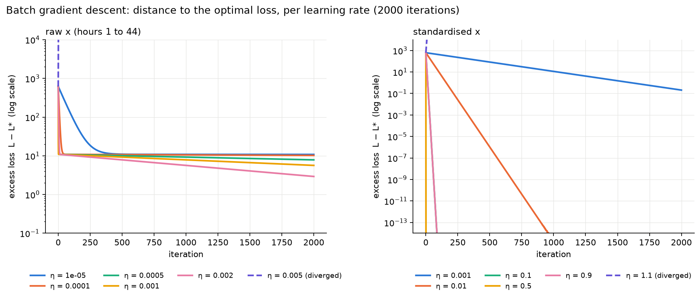
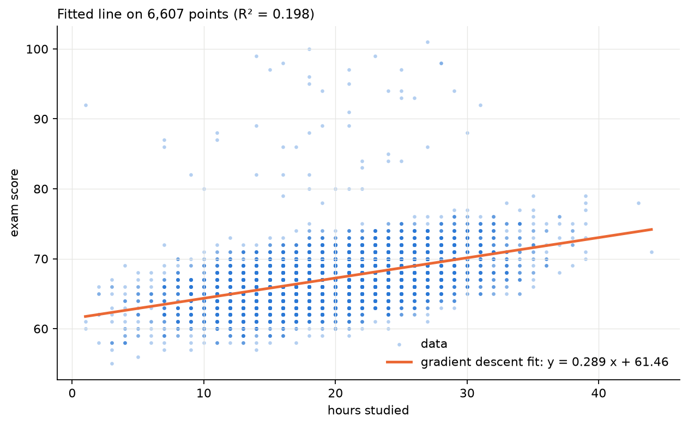

# Gradient descent from scratch: how the learning rate decides convergence

Batch gradient descent for linear regression written with NumPy only, used to measure which learning rates converge, crawl or diverge, and checked against the closed-form solution and scikit-learn.

**Live demo:** [gradient_descent_explorer.html](https://silentserpent19.github.io/ml-from-scratch/gradient-descent/gradient_descent_explorer.html) (drag a point on the loss surface, pick a learning rate, watch the descent).

## The problem

Fit a line $\hat{y} = m x + b$ predicting an exam score from hours studied, on 6,607 rows of the public Kaggle dataset [Student Performance Factors](https://www.kaggle.com/datasets/lainguyn123/student-performance-factors) (lainguyn123). The data is simple on purpose: the exact optimum is known in closed form, so the only question is how gradient descent behaves on the way there as the learning rate $\eta$ changes.

## The math in short

Mean squared error and its gradient, with residual $r_i = m x_i + b - y_i$:

$$L(m,b) = \frac{1}{n}\sum_i r_i^2, \qquad
\frac{\partial L}{\partial m} = \frac{2}{n}\sum_i x_i r_i, \qquad
\frac{\partial L}{\partial b} = \frac{2}{n}\sum_i r_i$$

Update rule: $m \leftarrow m - \eta\,\partial L/\partial m$, $b \leftarrow b - \eta\,\partial L/\partial b$.

Because $L$ is quadratic, its Hessian $H = \frac{2}{n}\begin{pmatrix}\sum x_i^2 & \sum x_i\\ \sum x_i & n\end{pmatrix}$ is constant, and gradient descent converges if and only if $\eta < 2/\lambda_{\max}(H)$. The ratio $\lambda_{\max}/\lambda_{\min}$ (condition number) sets how slowly the flattest direction converges.

## What I implemented

- `gradient_descent.ipynb`: loss, gradient, batch gradient descent, closed-form least squares and the 2x2 Hessian eigenvalues, all in NumPy. A learning-rate sweep on the raw data and on standardised $x$, a run-to-convergence experiment, and a comparison table against `sklearn.linear_model.LinearRegression`.
- `gradient_descent_explorer.html`: a standalone page (no build step, no libraries) that draws the data, the loss surface $L(m,b)$ as contour bands, the negative-gradient field, and animates the descent for any learning rate. The stability limit shown on the page is computed from the data when it loads.
- `data/student_performance.csv`: the two columns used, identical to the rows embedded in the explorer.

## Results

All runs start from $(m, b) = (2, 50)$ and take 2000 iterations. Closed-form optimum: $m^* = 0.289291$, $b^* = 61.456984$, $\text{MSE}^* = 12.1304$.

Hessian on the raw data: $\lambda_{\max} = 871.63$, $\lambda_{\min} = 0.1647$, condition number 5293, stability limit $\eta < 0.002295$. After standardising $x$: $H = 2I$, condition number 1, limit $\eta < 1$.

**Learning-rate sweep, raw x (hours 1 to 44)**

| η | iterations | final MSE | gap to MSE* | final m | final b | diverged |
|---|---|---|---|---|---|---|
| 1e-5 | 2000 | 22.9916 | 10.8612 | 0.8164 | 49.98 | no |
| 1e-4 | 2000 | 22.3665 | 10.2360 | 0.8010 | 50.32 | no |
| 5e-4 | 2000 | 19.9955 | 7.8651 | 0.7378 | 51.69 | no |
| 1e-3 | 2000 | 17.7884 | 5.6580 | 0.6697 | 53.18 | no |
| 2e-3 | 2000 | 15.0582 | 2.9278 | 0.5630 | 55.50 | no |
| 5e-3 | 9 | – | – | – | – | **yes** |

**Learning-rate sweep, standardised x** (parameters mapped back to the raw scale)

| η | iterations | final MSE | gap to MSE* | final m | final b | diverged |
|---|---|---|---|---|---|---|
| 1e-3 | 2000 | 12.3371 | 0.2067 | 0.3205 | 61.25 | no |
| 1e-2 | 2000 | 12.1304 | 1.8e-15 | 0.289291 | 61.457 | no |
| 0.1 | 2000 | 12.1304 | 1.8e-15 | 0.289291 | 61.457 | no |
| 0.5 | 2000 | 12.1304 | 0 | 0.289291 | 61.457 | no |
| 0.9 | 2000 | 12.1304 | 0 | 0.289291 | 61.457 | no |
| 1.1 | 59 | – | – | – | – | **yes** |

**Iterations needed to get within 1e-6 of MSE\***: 24,603 on the raw data with η = 0.002, versus 46 on standardised x with η = 0.9.

**From-scratch results versus the closed form and scikit-learn**

| method | slope m | intercept b | MSE | R² |
|---|---|---|---|---|
| closed form (NumPy) | 0.289291 | 61.4570 | 12.1304 | 0.1984 |
| scikit-learn `LinearRegression` | 0.289291 | 61.4570 | 12.1304 | 0.1984 |
| GD, raw x, η = 0.002, 2000 iterations | 0.562952 | 55.5001 | 15.0582 | 0.0050 |
| GD, raw x, η = 0.002, 24,603 iterations | 0.289451 | 61.4535 | 12.1304 | 0.1984 |
| GD, standardised x, η = 0.9, 2000 iterations | 0.289291 | 61.4570 | 12.1304 | 0.1984 |

The standardised run matches scikit-learn to 8e-16 in slope and 1e-14 in intercept. The low R² is a property of this dataset (hours studied alone explains about 20% of the score variance), not of the optimiser: every converged method lands on the same line.

## Charts





## How to run

```bash
# from the repository root
python3 -m venv .venv && source .venv/bin/activate
pip install -r requirements.txt
cd gradient-descent
jupyter notebook gradient_descent.ipynb     # Kernel > Restart & Run All
```

The explorer needs no setup: double-click `gradient_descent_explorer.html` or open the [live version](https://silentserpent19.github.io/ml-from-scratch/gradient-descent/gradient_descent_explorer.html).

## What I learned

- The learning rate is not a free knob. For a quadratic loss the admissible range is fixed by the largest Hessian eigenvalue, and the sweep lands exactly where the theory says: 2e-3 converges, 5e-3 blows up in 9 steps.
- "Converged" curves can be misleading. On the raw data every stable run looks flat after a few hundred iterations while the intercept is still 6 points off; plotting the excess loss $L - L^*$ on a log axis exposes that.
- Feature scaling is a conditioning fix, not a cosmetic one. It turns a condition number of 5293 into 1 and cuts the iterations to convergence from about 25,000 to 46.
- Checking a from-scratch optimiser against a closed form and a library is the fastest way to catch sign and scaling bugs.
