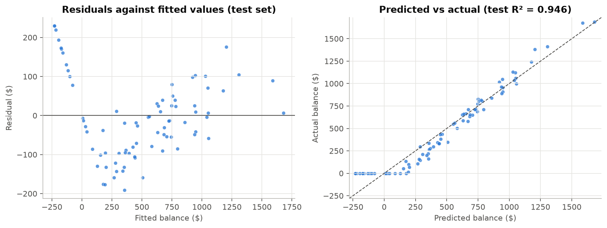
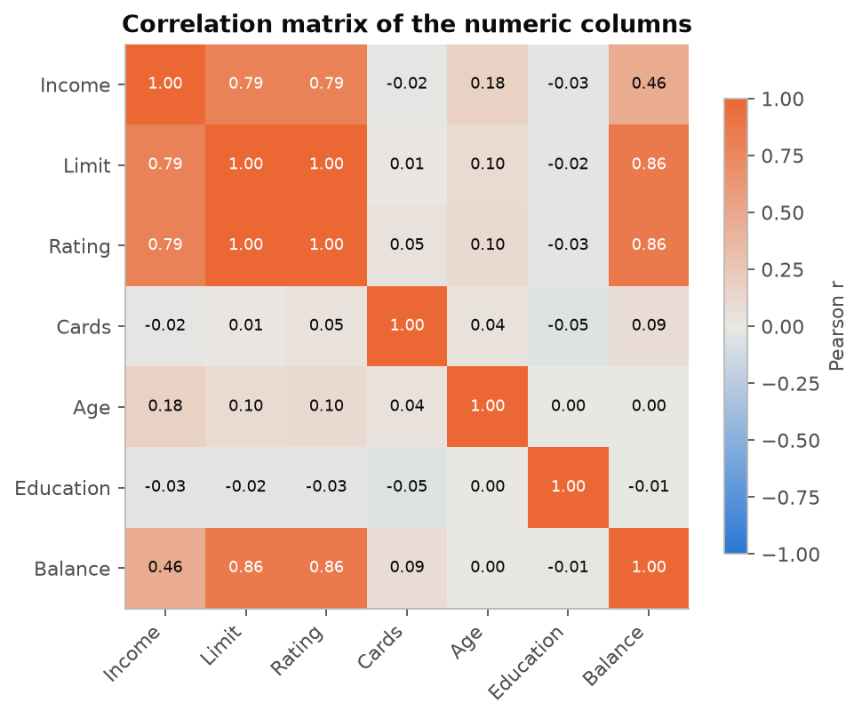
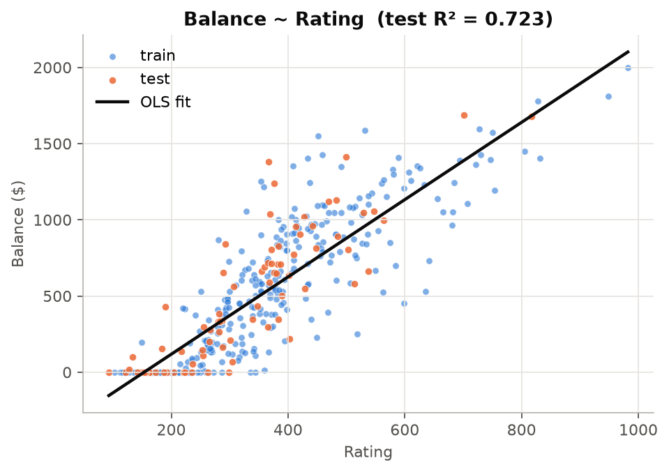

# Linear regression from scratch

Ordinary least squares written in NumPy, from a single-predictor model to a multivariate model with one-hot encoded categoricals and collinearity handling, verified against scikit-learn on a credit card dataset.



## The problem

400 credit card holders, 11 attributes each: income, credit limit, credit rating, number of cards, age, years of education, plus gender, student status, marital status and ethnicity. The target is the **balance** on the card.

Two questions:

1. How much of the balance does a single predictor, the credit rating, explain?
2. How much better does a full multivariate model do, and what has to happen to near-duplicate features such as `Limit` and `Rating` before it can be trusted?

## The math, briefly

Model and fit (with a leading column of ones in $X$ for the intercept):

$$\hat y = X\beta, \qquad \hat\beta = (X^\top X)^{-1}X^\top y$$

solved as the linear system $(X^\top X)\beta = X^\top y$ rather than by inverting the matrix.

Metrics on held-out data:

$$\mathrm{RMSE}=\sqrt{\tfrac1n\sum(y_i-\hat y_i)^2},\qquad \mathrm{MAE}=\tfrac1n\sum|y_i-\hat y_i|,\qquad R^2 = 1-\frac{\sum(y_i-\hat y_i)^2}{\sum(y_i-\bar y)^2}$$

Collinearity: the variance inflation factor of feature $j$ is $\mathrm{VIF}_j = 1/(1-R_j^2)$, where $R_j^2$ comes from regressing feature $j$ on all other features with the same solver.

## What I implemented

All in `linear_regression.ipynb`, with NumPy only for the model:

- train/test split (80/20, seed 42), design matrix with intercept, normal-equation fit, prediction
- RMSE, MAE and R² from their definitions
- VIF for every feature, reusing the OLS solver, plus the condition number of $X^\top X$
- one-hot encoding with the first level dropped to avoid the dummy variable trap
- EDA: summary statistics, histograms, scatter plot, correlation heatmap
- a residual plot and a predicted-vs-actual plot on the test set
- a side-by-side check against `sklearn.linear_model.LinearRegression` and `sklearn.metrics`

## Results

All numbers below are printed by the notebook.

**Single predictor.** `Balance = -389.12 + 2.5360 × Rating`. Fitting the same line separately for students and non-students gives almost the same slope (2.78 vs 2.51) but an intercept that is about 290 dollars higher for students: at equal rating, students carry a much higher balance, which a single line cannot express.

**Collinearity.** `Limit` and `Rating` have a correlation of 0.9969 and inflate each other:

| Feature | VIF with `Limit` | VIF without `Limit` |
|---|---|---|
| Limit | 234.03 | dropped |
| Rating | 235.85 | 2.73 |
| Income | 2.79 | 2.78 |
| every other feature | ≤ 1.55 | ≤ 1.55 |
| condition number of $X^\top X$ | 1.5 × 10⁹ | 7.5 × 10⁶ |

`Limit` is dropped; `Rating` is kept because it is the marginally stronger single predictor (r = 0.864 vs 0.862 with `Balance`).

**Single vs multivariate, test set (80 holders):**

| Model | R² | RMSE ($) | MAE ($) |
|---|---|---|---|
| Balance ~ Rating | 0.7228 | 230.65 | 168.83 |
| Multivariate, 10 features, no `Limit` | 0.9461 | 101.72 | 81.97 |

Largest multivariate effects: `Student_Yes` +420.16, `Income` −7.84 per thousand dollars (at fixed rating, higher income means lower balance), `Rating` +3.99 per point.

**Match with scikit-learn**, same splits and features:

| | From scratch | scikit-learn | max abs. difference |
|---|---|---|---|
| Rating-only coefficients | −389.1239, 2.5360 | −389.1239, 2.5360 | 1.7 × 10⁻¹³ |
| Multivariate coefficients (11 incl. intercept) | see notebook | identical to 6 decimals | 1.7 × 10⁻¹¹ |
| Multivariate test R² / RMSE / MAE | 0.946094 / 101.720064 / 81.974910 | 0.946094 / 101.720064 / 81.974910 | 0 at printed precision |

**What the residuals say.** 90 of the 400 holders carry a zero balance. The model predicts a small or negative balance for them, so their residuals form the diagonal streak in the left panel above. That structure, not noise, is most of the remaining error.

## Charts

| | |
|---|---|
|  |  |

## How to run

```bash
# from the repository root
python3 -m venv .venv && source .venv/bin/activate
pip install -r requirements.txt
cd linear-regression
jupyter lab linear_regression.ipynb      # Kernel → Restart and run all
```

Data: `data/credit_card.xlsx`. The notebook writes the three PNGs into `images/`.

## Dataset

The *Credit* dataset from *An Introduction to Statistical Learning* by James, Witten, Hastie and Tibshirani (https://www.statlearning.com/), 400 rows. The R package documentation describes it as a simulated dataset of card holders: https://search.r-project.org/CRAN/refmans/ISLR/html/Credit.html.

## What I learned

- A correlation heatmap is the fastest collinearity detector, but VIF puts a number on it and the condition number shows the global effect; a VIF above 200 means the two coefficients are effectively unidentifiable.
- One-hot encoding needs one level dropped per variable, otherwise $X^\top X$ is singular and the normal equation has no unique solution.
- Reproducing scikit-learn's coefficients to 10⁻¹¹ is the clearest unit test a from-scratch solver can have.
- Residual plots reveal what the metrics hide: a 0.95 R² still has a systematic failure on the zero-balance group, which calls for a two-part model rather than a better linear one.
