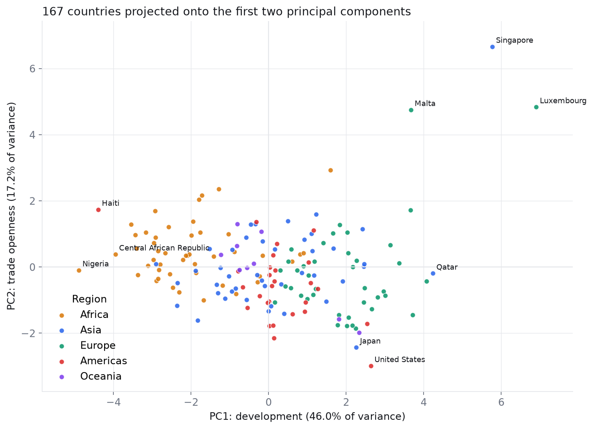
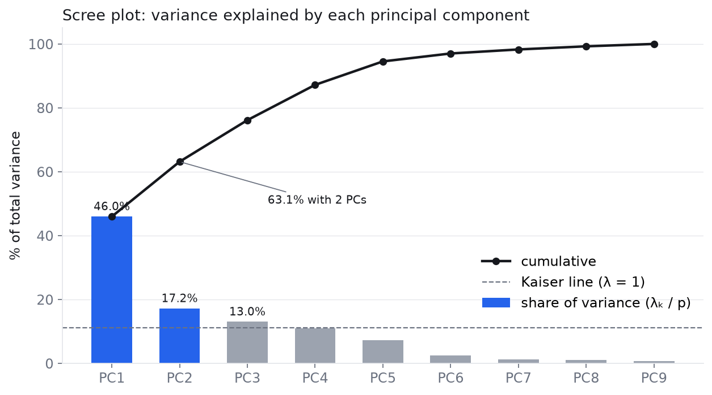

# PCA from scratch

Principal Component Analysis implemented by hand, twice: in NumPy (a cyclic Jacobi eigen-solver) and in plain JavaScript inside an interactive page that computes everything in the browser. 167 countries described by 9 socio-economic indicators are projected onto two dimensions, and the from-scratch results match `scikit-learn` to about 1e-15.

**Live demo:** https://silentserpent19.github.io/ml-from-scratch/pca/pca_explorer.html



## The problem

Each country is a point in $\mathbb{R}^9$ (child mortality, exports, health spending, imports, income, inflation, life expectancy, fertility, GDP per capita). PCA finds the orthogonal directions of largest variance so the cloud can be drawn in 2D or 3D with as little distortion as possible. The questions: how much variance does each component keep, and which indicators drive the first few components?

## The math in short

Standardise each column (sample std, ddof = 1), so every indicator counts equally:

$$\tilde{X}_{ij} = \frac{X_{ij} - \hat\mu_j}{\hat s_j}$$

The covariance of the standardised data is the correlation matrix, with trace $p = 9$:

$$R = \frac{1}{n-1}\tilde{X}^\top\tilde{X}$$

Diagonalise it, $R = V\Lambda V^\top$. The eigenvalues $\lambda_k$ are the variances along the principal axes, the columns of $V$ are the axes (loadings), and component $k$ explains $\lambda_k / p$ of the variance. Scores are $Z = \tilde{X}V$; the first two columns give the 2D map.

**Jacobi's method** does the diagonalisation with nothing but 2×2 rotations: pick an off-diagonal entry $a_{qr}$, rotate in the $(q, r)$ plane by the angle that zeroes it, repeat over every pair (one sweep). The off-diagonal norm shrinks every sweep; after 5 sweeps on this 9×9 matrix it is below 1e-12. The product of the rotations is $V$.

Eigenvectors are defined up to sign, so each column is oriented so that its largest-magnitude loading is positive.

## What I implemented

- `pca.ipynb`: standardisation, correlation matrix, cyclic Jacobi eigen-solver, sorting and sign convention, explained variance, loadings, scores, charts, and a comparison against `np.linalg.eigh` and `sklearn.decomposition.PCA`. No `np.linalg.eig`, `eigh` or `svd` is used for the PCA itself.
- `pca_explorer.html`: the same pipeline in JavaScript. The only thing stored in the file is the raw data table (identical to `data/countries.csv`). Means, standard deviations, the correlation matrix, eigenvalues, eigenvectors, explained variance and every score are computed when the page loads, and a verification line shows $\sum\lambda_k$, $\max|V^\top V - I|$, $\max|RV - V\Lambda|$ and the number of Jacobi sweeps. Plotly (pinned 2.26.0) is used only for drawing.

## Results

Jacobi converges in 5 sweeps (180 rotations). Sum of eigenvalues = 9.000000, max |VᵀV − I| = 3.3e-15.

| Component | Eigenvalue | Explained variance | Cumulative |
|---|---|---|---|
| PC1 | 4.136 | 45.95 % | 45.95 % |
| PC2 | 1.546 | 17.18 % | 63.13 % |
| PC3 | 1.170 | 13.00 % | 76.14 % |
| PC4 | 0.995 | 11.05 % | 87.19 % |
| PC5 | 0.661 | 7.34 % | 94.53 % |
| PC6 | 0.224 | 2.48 % | 97.02 % |
| PC7 | 0.113 | 1.26 % | 98.28 % |
| PC8 | 0.088 | 0.98 % | 99.26 % |
| PC9 | 0.067 | 0.74 % | 100.00 % |

Four components are needed to pass 80 % of the variance (87.19 %). The Kaiser rule (λ > 1) keeps three, with λ₄ = 0.995 just below the line.

Loadings of the first three components:

| Variable | PC1 | PC2 | PC3 |
|---|---|---|---|
| child_mort | −0.420 | +0.193 | −0.030 |
| exports | +0.284 | +0.613 | +0.145 |
| health | +0.151 | −0.243 | −0.597 |
| imports | +0.161 | +0.672 | −0.300 |
| income | +0.398 | +0.023 | +0.302 |
| inflation | −0.193 | −0.008 | +0.643 |
| life_expec | +0.426 | −0.223 | +0.114 |
| total_fer | −0.404 | +0.155 | +0.020 |
| gdpp | +0.393 | −0.046 | +0.123 |

PC1 is a development axis (life expectancy, income and GDP per capita against child mortality and fertility). PC2 is trade openness (imports and exports). PC3 contrasts inflation with health spending as a share of GDP. The strongest raw correlations are income–gdpp (+0.90), child_mort–life_expec (−0.89) and child_mort–total_fer (+0.85).

### Match with NumPy and scikit-learn

Signs were aligned per component before taking differences.

| Check | Max absolute difference |
|---|---|
| Eigenvalues, Jacobi vs `np.linalg.eigh` | 8.9e-15 |
| Explained variance ratio, from scratch vs `sklearn.decomposition.PCA` | 2.5e-16 |
| Loadings, from scratch vs scikit-learn | 2.7e-15 |
| Scores, from scratch vs scikit-learn | 2.0e-14 |
| Eigenvalues, browser JavaScript vs NumPy | 8.0e-15 |
| Scores, browser JavaScript vs NumPy (first 3 countries) | 4.0e-15 |

## Charts



The interactive page adds a correlation heatmap, a variance-threshold slider, a 3D view of PC1–PC3 and per-component loading charts.

## How to run

```bash
# from the repository root
python3 -m venv .venv && source .venv/bin/activate
pip install -r requirements.txt
cd pca
jupyter notebook pca.ipynb
```

The interactive explorer is a single file: double-click `pca_explorer.html` or open the live demo link above. It needs an internet connection only to load Plotly and the fonts from a CDN.

## What I learned

- Standardisation is not optional here: the standard deviations of income and GDP per capita are in the tens of thousands, fertility's is 1.5, so without it the first component would be "money" and nothing else.
- Jacobi rotations are a surprisingly short way to get a full, orthonormal eigendecomposition of a small symmetric matrix, and checking $V^\top V = I$ and $RV = V\Lambda$ at the end makes the implementation self-verifying.
- Eigenvector signs are arbitrary, so comparisons against a library must align signs first, and any interpretation ("positive PC1 means developed") depends on the convention you choose.
- The 2D map keeps 63 % of the variance, which is enough to see the structure (sub-Saharan Africa on one side, Western Europe on the other, small open economies far along PC2) but the Kaiser rule and the scree plot both say the data is really three- or four-dimensional.

## Data

[Unsupervised Learning on Country Data](https://www.kaggle.com/datasets/rohan0301/unsupervised-learning-on-country-data) (Kaggle), 167 countries × 9 indicators. The `region` column in `data/countries.csv` was added for colouring and is not used in the PCA.
